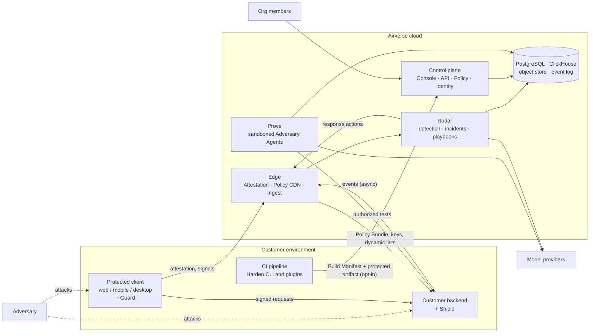
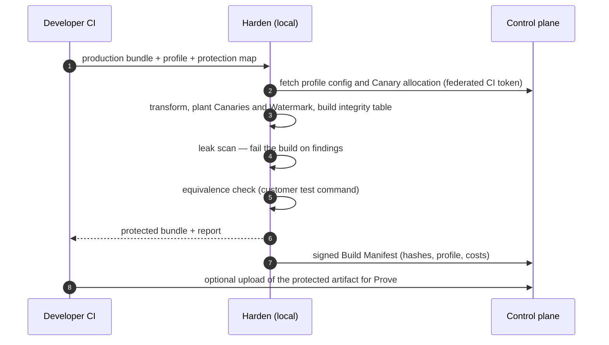
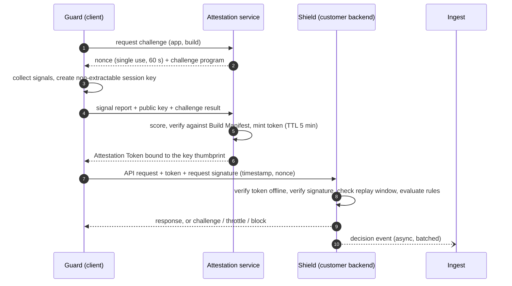
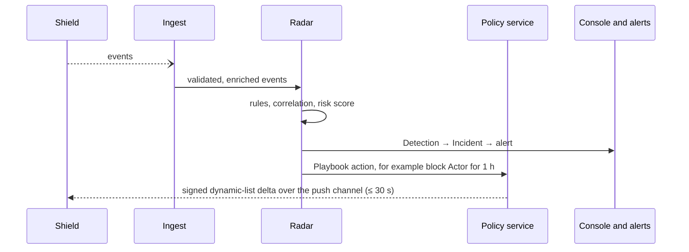
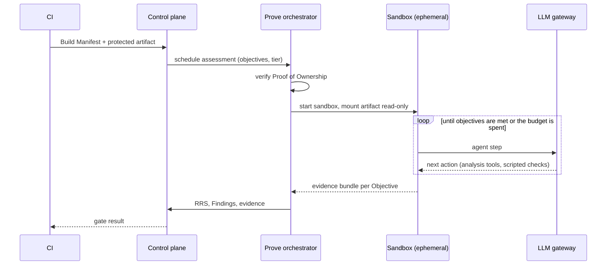
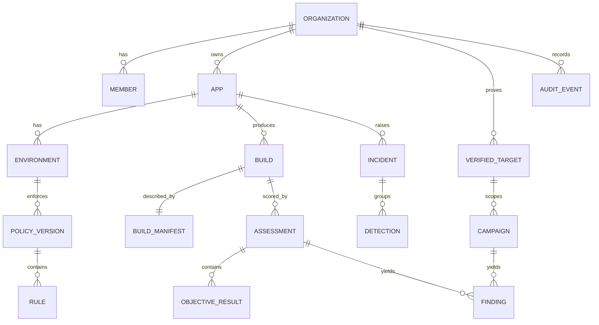

# Airverse — Software Design Document (SDD)

How the product in [PRD.md](PRD.md) is built. Numbers live in [PERFORMANCE.md](PERFORMANCE.md), threats and controls in [SECURITY.md](SECURITY.md), vocabulary in [MEMORY.md § Language](MEMORY.md#3-language-glossary). Technology choices marked **(call)** are proposals made without your input and are listed in PRD §17.

---

## 1. Purpose and design principles

| # | Principle | Consequence |
|---|---|---|
| P1 | **The client is hostile territory.** | Guard produces evidence; only server-side code decides. |
| P2 | **Airverse is never on the hot path.** | Shield decides locally from a signed bundle; telemetry is asynchronous; failure means fail-open. |
| P3 | **Local-first for anything sensitive.** | Source and unprotected builds stay in the customer's CI. |
| P4 | **Signed everything.** | Policy Bundles, Attestation Tokens, Build Manifests, SDK releases, remote config and webhooks carry verifiable signatures. |
| P5 | **Monitor before enforce; every change reversible.** | New rules observe first; one action rolls back. |
| P6 | **Deep modules.** | Each module hides a lot behind a small interface with one external seam; a seam is only introduced when two adapters exist or are planned. |
| P7 | **Evidence over claims.** | Each protection maps to an Objective that Prove measures. |
| P8 | **Dual-use containment.** | Offensive capability exists only inside ownership-verified scope, in disposable sandboxes. |
| P9 | **Data minimisation.** | Collect what a decision needs, pseudonymise Actors, expire by default. |
| P10 | **Boring infrastructure, replaceable engines.** | Proven data stores; third-party engines behind adapters. |

## 2. System context



## 3. Containers and trust zones

| Zone | Contains | Trust | Notes |
|---|---|---|---|
| Z0 | Internet, Adversary | None | |
| Z1 | Protected client with Guard | **Untrusted** | Everything here can be read and modified |
| Z2 | Customer CI with Harden | Trusted by the customer | Holds source; Airverse cloud never sees it |
| Z3 | Customer backend with Shield | Trusted by the customer | Holds the Shield key; verifies everything from Z1 |
| Z4 | Airverse edge: Attestation, Ingest, Policy CDN | Public-facing | Stateless, regional, rate-limited |
| Z5 | Control plane: Console, API, Policy, Identity, Billing | Private | Reached only through the API gateway |
| Z6 | Data stores | Private | No direct access from Z4 except through narrow service roles |
| Z7 | Prove sandboxes | **Hostile by assumption** | Separate cloud account, no credentials, egress allowlist |
| Z8 | Third parties: model providers, email, chat, payments | External | Reached through dedicated gateways with redaction |

## 4. Modules, interfaces and seams

The **interface** column is everything a caller must know. The **seam** column names where behaviour can be swapped; it is also the test surface.

| Module | Interface | Hides | External seam and adapters |
|---|---|---|---|
| **Harden** | `harden(artifact, profile, protectionMap) → { protected, manifest, report }` | Transform passes, diversity seed, Canary and Watermark planting, leak scan, equivalence check | Artifact kind (web now; Android, iOS, desktop later); bundler plugins |
| **Guard** | `init(config)`, `attest() → token`, `sign(request) → headers`, `on(signal, handler)` | Signal collectors, key handling, handshake, remote config, self-checks | Platform (browser now; Android, iOS later); transport |
| **Shield** | `decide(request, context) → Decision` plus thin framework adapters | Bundle loading and verification, token and signature checks, rule evaluation, counters, event batching | Framework (Express, Fastify, Next.js, Hono); counter store (memory, Redis); event transport |
| **Policy** | `compile(source) → signedBundle`, `simulate(source, window) → impact` | Rule language, validation, signing, distribution | Signer (KMS); distribution channel |
| **Attestation** | `challenge()`, `attest(report) → token` | Scoring, build verification, key rotation | Platform verifier (web now; store attestation APIs later) |
| **Ingest** | `POST /v1/events` (batch) → ack | Authentication, schema validation, enrichment, partitioning | Event log |
| **Radar** | `evaluate(events) → detections`, `group(detections) → incidents`, `respond(incident) → actions` | Rule engine, windows and sequences, risk scoring, guardrails | Notifier (email, Slack, webhook, PagerDuty) |
| **Prove** | `assess(build, objectives, tier) → Assessment`, `runCampaign(target, roe) → Findings` | Orchestration, sandbox lifecycle, scoring, evidence, normalisation | `ReverseToolbelt` (REA), `PentestEngine` (PentAGI), `Sandbox` (container microVM, dedicated VM) |
| **LLM gateway** | `complete(task, input, budget) → result \| refusal` | Provider credentials, model routing, caching layout, redaction, spend caps | Provider (Anthropic first; self-hosted later) |
| **Identity and tenancy** | `authorize(principal, action, resource) → allow \| deny` | Sessions, SSO, roles, API keys, federated CI tokens | Identity provider |
| **Console and API** | REST resources (§15) and the web UI | View composition, real-time fan-out | — |

## 5. Key flows

### 5.1 Build and harden



### 5.2 Attestation and signed request



### 5.3 Detection to enforcement



### 5.4 Reverse Assessment



### 5.5 Pentest Campaign

1. An Owner verifies a target (DNS record or well-known file) and signs the Rules of Engagement.
2. The orchestrator re-verifies ownership, then boots a dedicated, single-tenant virtual machine running the pentest engine built from source at a pinned version.
3. A flow is created through the engine's API with a prompt assembled from the Rules of Engagement: target, scope, exclusions, intensity, expected output.
4. The machine's egress is restricted to the Verified Targets, the LLM gateway and package mirrors. Cloud metadata and private address ranges are denied.
5. The orchestrator watches flow status and target health. Kill conditions — manual stop, window end, target error-rate spike, ownership check failure — terminate the machine.
6. The report and task data are pulled through the engine's API, normalised into Findings, de-duplicated, marked *unverified* until an automated retest reproduces them, then published.
7. The machine and its disks are destroyed; evidence stays in the tenant's encrypted store.

## 6. Data model



| Store | Holds | Notes |
|---|---|---|
| PostgreSQL | Organizations, members, Apps, Environments, Builds, manifests, policies, Incidents, Findings, Campaigns, targets, keys, audit, usage | Row-level security on `tenant_id`; prefixed identifiers (`org_`, `app_`, `bld_`, `pol_`, `rul_`, `inc_`, `fnd_`, `cmp_`, `tgt_`) |
| ClickHouse | Events, one-minute rollups, Actor features | Ordered by `(tenant_id, app_id, ts)`; daily partitions; row policies |
| Object store | Protected artifacts, evidence bundles, reports, cold event archive | Per-tenant prefix and data key |
| Event log | Ordered event stream, detections, actions | Partition key = tenant |
| Cache | Sessions, counters, real-time fan-out | Namespaced per tenant |

**Event (wire format, abbreviated):**

```json
{
  "event_id": "0193b1c2-7d3e-7a10-9c1f-5b2e8a4d6f01",
  "protocol": 1,
  "tenant_id": "org_7Kp2",
  "app_id": "app_9f2c",
  "environment": "production",
  "surface": "api",
  "ts": "2026-11-10T08:15:30.412Z",
  "type": "request.decision",
  "actor": { "device": "dev_h:4c1e…", "ip": "203.0.113.0/24", "asn": 64500, "country": "ID", "account": "acc_h:9a77…" },
  "request": { "method": "POST", "route": "/api/login", "status": 429, "latency_ms": 3 },
  "signals": [ { "id": "automation.webdriver", "confidence": 0.9 } ],
  "decision": { "action": "throttle", "rule_id": "rul_login_stuffing", "policy_version": 42, "mode": "enforce", "risk": 81 },
  "build": { "build_id": "bld_2x8Q", "version": "1.14.0" },
  "sdk": { "name": "shield-node", "version": "0.3.1" }
}
```

No request or response bodies, no query strings, no raw account identifiers. Route is the template, not the URL. IP handling is specified in SECURITY.md §8.

## 7. Protocols and formats

| Artifact | Format | Signed with | Lifetime | Verified by |
|---|---|---|---|---|
| Policy Bundle | Canonical JSON + detached signature | Ed25519 (key in KMS) | Until superseded; `not_after` 7 days | Shield at load |
| Dynamic-list delta | Canonical JSON + signature | Ed25519 | Entry TTL (default 1 h) | Shield on receipt |
| Attestation Token | JWT, EdDSA | Attestation key, rotated daily with overlap | ≤ 5 min | Shield, offline, cached key set |
| Request signature | Header `X-AR-Sig: v1,t=<unix>,n=<nonce>,s=<sig>` over method, route, body hash, `t`, `n` | Client session key (ECDSA P-256, non-extractable) | ±60 s window, nonce single-use | Shield |
| Build Manifest | JSON | CI identity (federated token) + tenant build key | Permanent | Control plane, Attestation, Prove |
| Guard remote config | JSON + signature | Ed25519 | 24 h | Guard |
| Webhook | `AR-Signature: t=<unix>,v1=<hmac>` | HMAC-SHA256 per endpoint secret | 5 min tolerance | Customer receiver |

**Attestation Token claims:** `iss`, `aud` (App), `sub` (pseudonymous device), `iat`, `exp`, `jti`, `bid` (Build), `cnf` (session public key), `verdict` (`trusted | suspect | hostile`), `risk` (0–100), `sig` (compact signal set), `pv` (protocol version).

**Distribution.** Shield fetches the Policy Bundle from the CDN at start and holds a server-sent-events push channel for version changes and list deltas, with 30-second polling as fallback. A Shield that cannot reach Airverse keeps enforcing its last valid bundle — past `not_after` it reports the bundle as stale instead of dropping protection. Shield never loads a bundle that is already expired, tampered with, or older than one it has applied. A Shield that has never loaded a bundle runs a built-in monitor-only policy.

**Versioning.** Every SDK message carries a protocol version. The cloud accepts the current and previous major versions; SDK support windows are in OPERATION.md §6.

## 8. Harden design

**Pipeline:** parse → analyse (protection map, hot-path hints) → transform passes → plant (Canaries, Watermark, integrity table, origin lock) → emit → leak scan → equivalence check → Build Manifest.

| Pass | `light` | `balanced` | `maximum` | Purpose |
|---|---|---|---|---|
| Identifier mangling | ✓ | ✓ | ✓ | Remove meaning from names |
| String encryption with lazy decode | ✓ | ✓ | ✓ | Hide endpoints, messages, keys to logic |
| Integrity self-checks | ✓ | ✓ | ✓ | Detect modification |
| Origin lock and Clone Beacon | ✓ | ✓ | ✓ | Detect and report unauthorized hosting |
| Control-flow flattening | — | Selected modules | ✓ | Defeat structural recovery |
| Opaque predicates | — | ✓ | ✓ | Resist static simplification |
| Bounded dead-code injection | — | ✓ | ✓ | Raise analysis cost |
| Server-bound challenge programs | — | ✓ | ✓ | Make stubbing Guard detectable |
| Code virtualization (Phase 3) | — | — | Selected functions | Highest-cost recovery |

- **Diversity.** A seed derived from a tenant secret and the Build identifier drives naming, pass ordering and encoding variants. Two Builds of identical source differ structurally, so tooling written against one does not transfer.
- **Canaries.** Three kinds: decoy keys that look real, decoy routes, decoy configuration strings. The control plane allocates them per Build and Radar watches for any use.
- **Watermark.** Encoded in the choice among semantically neutral variants; the Console's *Identify build* tool recovers it from a leaked bundle.
- **Leak scan.** Blocks public source maps, high-entropy secrets and known key formats, debug endpoints, internal hostnames and unminified vendor code flagged as sensitive.
- **Engine.** Passes implement one `Pass` interface. MVP passes are built on mature open-source syntax-tree tooling and an open-source obfuscation core; in-house passes replace them as RRS evidence shows where the weak points are.
- **Stated limits.** Hardening raises cost; it does not make code unreadable. Secrets that must stay secret belong on the server. Per-path opt-out is always available.

## 9. Guard design

**Lifecycle:** async load → idle-time initialisation in small tasks → staged signal collection → attestation → steady state (re-attest before expiry, event-driven signals) → batched reporting.

| Signal | Observes | Confidence | Used for |
|---|---|---|---|
| `tamper.integrity_mismatch` | Code region hash differs from the Build Manifest | High | Verdict `hostile` |
| `tamper.guard_modified` | Guard self-check failed or challenge program result wrong | High | Verdict `hostile` |
| `hook.native_api` | Patched network, crypto or reflection primitives | High | Verdict `suspect` or `hostile` |
| `origin.unauthorized` | Running on an origin outside the signed allowlist | High | Clone Beacon |
| `canary.touched` | Client-side Canary read or used | High | Incident |
| `automation.webdriver` | Automation and headless markers | Medium–high | Bot rules |
| `debugger.attached` | Timing and trap heuristics | Medium | Risk score |
| `env.inconsistent` | Declared platform contradicts observed features | Medium | Risk score |
| `devtools.open` | Developer tools heuristics | Low | Informational only |

- **Identity without tracking.** The device identifier is a random first-party value created at install. It is not a cross-site fingerprint and resets when the user clears site data.
- **Self-protection.** Guard is itself processed by Harden with per-Build diversity. The Attestation service issues randomized challenge programs whose correct result depends on untampered code and the nonce.
- **Reactions.** Report-only by default. Optional: degrade a feature, call a customer handler. Guard never blocks the UI on its own in MVP.
- **Safety.** A signed remote configuration can disable any collector or the whole runtime within minutes (kill switch).

## 10. Shield design

**Per request:** normalise (route template, client address from an explicit trusted-proxy configuration) → extract token and signature → verify → build context (counters, lists, signals) → evaluate rules in order → act → emit.

```yaml
# Policy source (authoring form). Compiled into a signed Policy Bundle.
version: 1
app: app_9f2c
environment: production
defaults: { mode: monitor, on_error: fail_open }
rules:
  - id: rul_login_stuffing
    match: { route: "POST /api/login" }
    when: "rate(key=ip, window=60s) > 10 or rate(key=device, window=60s) > 5"
    action: challenge
    mode: enforce
  - id: rul_api_requires_attestation
    match: { route: "/api/**", except: ["/api/public/**", "/api/webhooks/**"] }
    when: "attest.verdict != 'trusted'"
    action: block
    mode: monitor          # promoted to enforce after the learning period
  - id: rul_hostile_client
    when: "signal('tamper.integrity_mismatch') or signal('hook.native_api')"
    action: block
    mode: enforce
    rollout: 25            # percent of matching traffic
```

- **Evaluation.** Rules compile to a decision tree. `monitor`-mode rules record what they would have done and never terminate evaluation. The first terminal action wins.
- **Expression vocabulary.** `rate()`, `signal()`, `attest.*`, `req.*`, `actor.*`, `list()`, `geo.*`. No user-defined code in MVP.
- **Counters.** Token bucket and sliding window, in memory per instance or shared through the customer's Redis.
- **Challenge.** A proof-of-work or re-attestation exchange handled transparently by Guard; non-Guard clients receive a structured `challenge` response.
- **Deceive.** Decoy response templates and bounded delay.
- **Events.** Every non-`allow` decision is emitted. `allow` decisions are sampled and summarised as one-minute rollups computed inside Shield, so dashboards stay exact without shipping every event.
- **Failure policy.** Any internal error resolves to the route's configured stance: fail-open (default) or fail-closed.

## 11. Radar design

**Pipeline:** Ingest → event log → enrich (network, policy context) → detect (stateless rules, stateful windows, sequences) → group into Incidents by Actor, App and technique → notify and run Playbooks.

```yaml
# Managed detection rule (abbreviated)
id: det_credential_stuffing
title: Credential stuffing against a login route
severity: high
maps_to: { owasp_automated_threat: "OAT-008", owasp_api: "API2:2023" }
source: { type: request.decision, route_tag: auth.login }
condition:
  window: 5m
  group_by: [actor.ip_prefix]
  having: "count(status in [401,403,429]) > 50 and distinct(actor.account) > 20"
respond:
  playbook: contain_actor
  ttl: 1h
```

- **Actor risk score.** A time-decayed weighted sum of signals and detections, always shown with its top contributing factors.
- **Playbook guardrails.** Every automated action has a TTL (default 1 h). Automation may affect at most 1 % of the last hour's Actors without human approval. Allowlisted addresses are never blocked. Every action is audited and reversible.
- **Managed rule packs.** Tampered client, replayed request, Canary use, Clone Beacon, credential stuffing, scraping, enumeration, API probing, fake-account creation — each mapped to recognised taxonomies where one applies.
- **Real time.** The Console subscribes to a per-tenant stream; the live feed is server-sent events.

## 12. Prove design

### 12.1 Reverse Resistance Score

`RRS = round(100 × Σ wᵢ × rᵢ)` over the Objectives of a Surface, `Σ wᵢ = 1`.

| Earliest Budget Tier at which the Objective was achieved | `rᵢ` |
|---|---|
| T1 — 15 min, 150 tool calls | 0.0 |
| T2 — 2 h, 1,500 tool calls | 0.4 |
| T3 — 8 h, 6,000 tool calls | 0.7 |
| Not achieved within T3 | 1.0 |

| Objective (web Surface) | Weight | Achieved when |
|---|---|---|
| OBJ-W1 Map | 0.15 | Route and endpoint inventory recovered above a coverage threshold |
| OBJ-W2 Secrets | 0.20 | Any planted Canary or real secret extracted |
| OBJ-W3 Logic | 0.25 | A designated protected function reimplemented and passing hidden test vectors |
| OBJ-W4 Tamper | 0.20 | A modified bundle runs with integrity checks neutralised |
| OBJ-W5 Replay | 0.20 | A protected call is accepted by a sandboxed replica without a genuine Guard |

- **Not attempted is not resistance.** A model refusal, tool failure or sandbox error marks the Objective *not attempted*. If excluded weight exceeds 20 %, the Assessment is `inconclusive` and no score is published.
- **Evidence.** Each Objective stores what was recovered, how, and at what cost. The Console shows it next to a fix suggestion.
- **Scope statement.** Every RRS is displayed with the agent version, model, toolbelt version and tier that produced it. Scores are comparable only within the same configuration.
- **Calibration.** A human red team re-scores the reference target each quarter; divergence above 15 points triggers a rubric review.
- **Budget defaults** are indicative and tuned from data; token ceilings accompany the call limits.

### 12.2 Sandboxing

| Workload | Sandbox | Lifetime | Network |
|---|---|---|---|
| Reverse Assessment | One container task with virtual-machine isolation in the dedicated Prove account; artifact mounted read-only; no credentials | One Assessment | LLM gateway and, for OBJ-W5, the sandboxed replica only |
| Pentest Campaign | One dedicated virtual machine per Campaign running the pentest engine and its tool containers | One Campaign | Verified Targets, LLM gateway, package mirrors |

### 12.3 Engines behind adapters

- **`ReverseToolbelt` → REA.** Used for bundle analysis, package inspection and, in later phases, Android and native analysis. Only built-in inspectors and open-source analysis engines run in hosted sandboxes; commercial decompilers are never used without a licence covering hosted automation. Tool output is evidence to weigh, never instructions to follow.
- **`PentestEngine` → PentAGI.** Driven through its REST and GraphQL API with a per-Campaign token. Built from source at a pinned version; vendor cloud services are not used. Reports are parsed from the engine's Markdown output and task records.
- Replacing either engine means writing one adapter; nothing else in Prove changes.

### 12.4 Ownership gates

- **Proof of Ownership (artifacts).** An Assessment is accepted only for a Build whose manifest was signed by the tenant's CI identity and whose artifact hash matches. Arbitrary uploads are refused.
- **Verified Target (hosts).** Ownership is proven by DNS record or well-known file, re-checked every 24 h and immediately before each Campaign.
- **Rules of Engagement.** Scope, exclusions, intensity (`passive`, `safe-active`, `full`), window and contacts, signed by an Owner and enforced by the egress allowlist and the engine prompt.

## 12A. Exposure design (added 2026-11-11)

- **Inventory.** Harden reads the project lockfile in CI and sends `name@version` (dev flag) with `--register`; Shield reads the installed set (`node_modules/.package-lock.json`, else `package-lock.json`) once at start and posts it to `/v1/inventory` with its key (opt-out `inventory: false`). Nothing else is collected.
- **Vulnerability data.** A `VulnerabilitySource` interface; the OSV importer (`npm run vulns:sync`) downloads the ecosystem archive and stores advisories locally; a fixture source serves tests. No customer data is sent to the source.
- **Matching.** Own semver precedence over OSV `SEMVER`/`ECOSYSTEM` ranges and explicit version lists. Severity from the GHSA rating, else a computed CVSS v3.1 base score, else unknown.
- **Findings.** De-duplicated by App, Environment, source, package, version and advisory; `fixed` when the next inventory from that source lacks the version; ignores need a reason and an expiry. A new Critical or High finding opens a `vulnerable-component` Incident through Radar.
- **Virtual patches (step 2).** Signed managed rules per advisory, shipped only to Shields whose inventory has the vulnerable version.

## 13. AI layer

| Task | Default model | Mode |
|---|---|---|
| Adversary Agent for Reverse Assessments | `claude-opus-5-5` | Tool-use loop hosted by the Prove orchestrator; streaming; ceilings enforced by the orchestrator |
| Pentest engine reasoning | Configured through the gateway | Engine-managed |
| Finding normalisation, de-duplication, taxonomy mapping | `claude-haiku-5-5` | Batch (asynchronous, lower cost) |
| Incident triage summary | `claude-haiku-5-5`; escalate to `claude-opus-5-5` on request | Interactive, streamed |
| Weekly report narrative | `claude-haiku-5-5` | Batch |
| Detection-rule suggestions | `claude-opus-5-5` | On demand |

Rules for every call through the LLM gateway:

1. **Stable prefix, volatile suffix.** System prompt and tool definitions are frozen per release so prompt caching applies; per-request content comes last. Cache hit rate is monitored.
2. **Untrusted content is data.** Artifact text, HTTP responses and event fields are delimited and declared as untrusted; the agent's tool list is an allowlist.
3. **Structured outputs.** Results are validated against schemas before use.
4. **Refusals are first-class.** A provider refusal is returned as `refusal` with its category, recorded, and never counted as attacker failure. Security workloads may fall under provider safeguards; whether to apply for provider-verified access is an open decision.
5. **Minimise and redact.** No secrets, tokens or raw end-user identifiers in prompts.
6. **Spend caps** per tenant, per task and per Campaign.
7. **Retention terms** of each provider and model are recorded; tenants can opt out of third-party processing, which disables AI summaries and, until a self-hosted model is supported, Reverse Assessments.
8. **AI output is labeled** wherever it is shown.

## 14. Multi-tenancy and isolation

- `tenant_id` on every row and every event. PostgreSQL row-level security is enforced per transaction; service roles cannot bypass it.
- ClickHouse access goes through a query service that always injects the tenant predicate; clients never send SQL.
- Object-store prefixes and envelope encryption with a data key per tenant.
- Cache keys, log partitions and rate limits are namespaced per tenant; quotas protect against noisy neighbours.
- Authorization is one function — role, resource scope and plan entitlements — called by every endpoint.
- Enterprise: dedicated clusters or a private data plane, and customer-managed keys.

## 15. Public API and integrations

| Resource | Purpose |
|---|---|
| `/v1/organizations`, `/v1/members` | Tenancy and roles |
| `/v1/apps`, `/v1/apps/{id}/environments`, `/v1/apps/{id}/builds` | Apps, Environments, Builds and manifests |
| `/v1/policies`, `/v1/policies/{id}/versions`, `/v1/policies/{id}/simulate` | Authoring, publishing, simulation, rollback |
| `/v1/lists` | Allow and block lists |
| `/v1/events`, `/v1/events/search` | Ingest and query |
| `/v1/incidents`, `/v1/detections` | Triage and response |
| `/v1/targets`, `/v1/campaigns`, `/v1/assessments`, `/v1/findings` | Prove |
| `/v1/attest/*` | Guard handshake (edge) |
| `/v1/webhooks`, `/v1/api-keys`, `/v1/audit` | Integration and governance |

Conventions: JSON over HTTPS, OpenAPI 3.1 contract, cursor pagination, idempotency keys on writes, problem-details errors, scoped keys, per-key rate limits.

**MCP server (Phase 2).** Read-mostly tools for coding agents — list Findings, fetch RRS evidence, list Incidents, trigger an Assessment — authenticated with a scoped token. No destructive tools.

## 16. Technology stack

All rows are **(call)** unless you decide otherwise.

| Layer | Choice | Why |
|---|---|---|
| Languages | TypeScript for services, SDKs, CLI and Console; Rust for the Guard WASM core and hot stream processors when scale requires | One language across the seams; Rust where tamper resistance or throughput needs it |
| Repository | Monorepo with shared protocol package | Protocol changes land atomically across SDKs and services |
| Console | Next.js (App Router), React, Tailwind, component primitives per UIUX.md | Mature, fast to build |
| Services | Node.js LTS, HTTP framework with schema validation, OpenAPI-first | Shared types with SDKs |
| Relational store | PostgreSQL with row-level security | Tenancy model, transactions |
| Analytics store | ClickHouse | High-volume event analytics |
| Event log | Kafka-compatible | Ordering, replay, consumer groups |
| Cache | Redis-compatible | Counters, sessions, fan-out |
| Objects | S3-compatible storage | Artifacts, evidence, archive |
| Keys | Cloud KMS; HSM-backed signing keys | Signed everything |
| Cloud | AWS primary; CDN for bundles, key sets and Guard assets | Regions near first customers, managed data services |
| Infrastructure as code | AWS CDK in TypeScript | Same language as the codebase |
| Observability | OpenTelemetry traces, metrics and logs | Vendor-neutral |
| Console hosting | Managed Next.js hosting or containers — decided by ADR; nothing depends on it | Keep options open |

## 17. Deployment topology

- **Accounts:** production core, production edge, production Prove (isolated, no peering to core), staging, development, security/audit.
- **Regions:** one primary region with three availability zones at launch; edge services (Attestation, Ingest, Policy CDN) in at least two regions, active-active. The first region is an open question (PRD §17, Q5).
- **Network:** private subnets for services and data; Prove egress only through an allowlisting proxy; no inbound to sandboxes.
- **Release:** progressive delivery with automatic rollback on SLO burn (OPERATION.md §5).

## 18. Failure modes and degradation

| Failure | Effect on the customer | Designed behaviour |
|---|---|---|
| Airverse cloud unreachable from Shield | None on requests | Last valid bundle stays in force; events buffer in memory with a cap, then drop with a counter |
| Shield has never loaded a bundle | No enforcement | Built-in monitor-only policy; health event |
| Attestation service down | Guard cannot refresh tokens | Shield applies the grace period (default 15 min), then the route's fail stance |
| Bad policy published | Possible false blocks | Percentage rollout, automatic halt on block-rate anomaly, one-action rollback |
| Bad Guard release | Possible client errors | Signed kill switch disables collectors; CDN pin to previous version |
| Ingest backlog | Delayed detection | Autoscale consumers; shed sampled `allow` events first; alert at lag thresholds |
| Model provider outage or refusal | No AI summaries; Assessments inconclusive | Features degrade visibly; deterministic checks still run; no score is fabricated |
| Signing key compromise | Forged bundles or tokens possible | Rotation runbook, key-set update, forced bundle refresh (OPERATION.md RB-06) |
| Sandbox anomaly | None on tenants | Sandbox terminated, account isolated, evidence quarantined |
| Clock skew on customer hosts | Signature window failures | Tolerance window, skew metric, clear error event |

## 19. Decision index and open design questions

Decisions are recorded once, with reasons, in [MEMORY.md § Decision log](MEMORY.md#4-decision-log): D-001 product form, D-003 local-first hardening, D-004 local Shield decisions, D-005 client signals as evidence, D-006 ownership gates, D-007 sandboxing, D-008 stack, D-011 RRS positioning, D-013 LLM gateway, D-014 analysis engines, D-015 pentest engine adapter.

Open design questions:

1. Console hosting target (managed Next.js hosting vs containers).
2. Event-log product (self-managed vs managed Kafka-compatible service).
3. Approximate global rate limiting across Shield instances without the customer's Redis.
4. Self-hosted model option for tenants that opt out of third-party processing.
5. Whether `challenge` should include an interactive human check in a later phase.

## 20. Left to the builder

Internal structure of each module; choice of libraries inside a module; exact rule-engine compilation strategy; storage schemas beyond the entities and keys named here; UI component implementation within the system in [UIUX.md](UIUX.md). Constraints that are not negotiable: the principles in §1, the interfaces in §4, the formats in §7, the budgets in PERFORMANCE.md and the controls in SECURITY.md.
